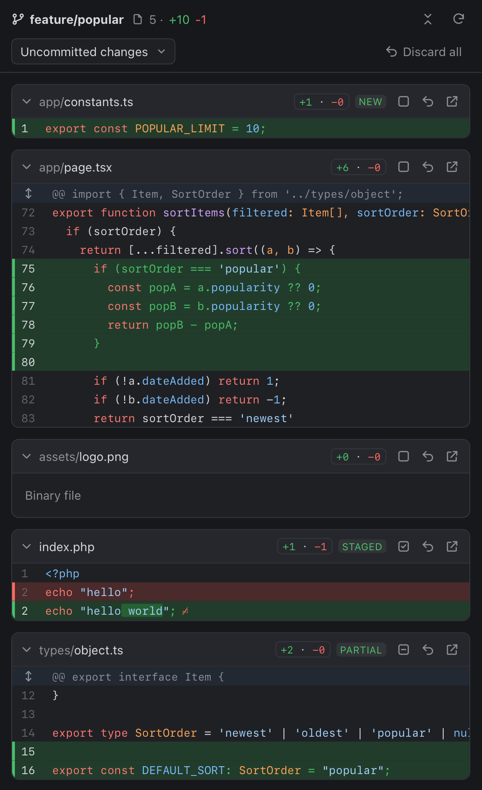
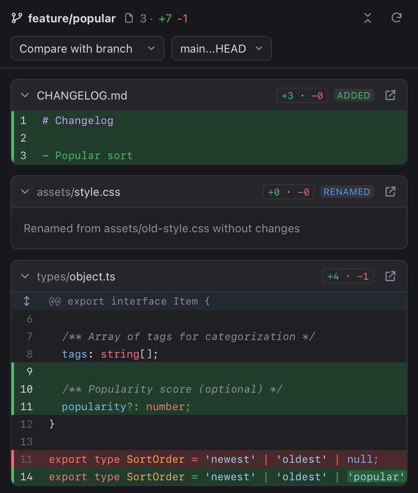
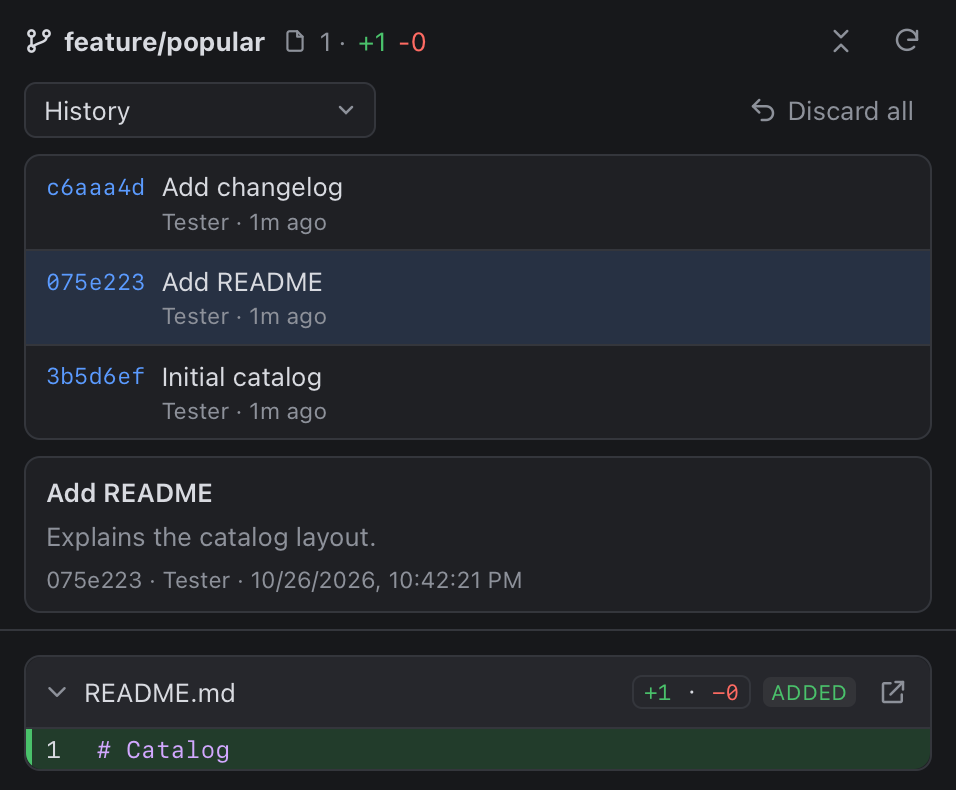

# cmux-git-review

[cmux](https://cmux.com)'un sağ panelinde (**Dock**) çalışan git review paneli: kaydedilmemiş değişiklikler, commit geçmişi ve branch karşılaştırması. Dosya bazında stage / unstage / discard da yapılabiliyor.

<p>
  
  
  
</p>

## Nasıl çalışır

cmux'un custom sidebar'ları dosya okuyamıyor ve komut çalıştıramıyor, bu yüzden git'e doğrudan erişemiyor. Bu araçta yerel küçük bir Node sunucusu git'i çalıştırıyor; panel de Dock'ta adres çubuğu olmayan bir browser sekmesi olarak açılıyor.

```
cmux terminali ── cmux-review open ──► yerel sunucu (127.0.0.1:47391) ──► git
                                              ▲
cmux Dock ── browser sekmesi ─────────────────┘
```

## Gereksinimler

- macOS + cmux 0.65 veya üstü (Dock ve `--placement dock` desteği)
- Node.js 20+ ve pnpm
- git

## Kurulum

```sh
git clone https://github.com/baransomakli/cmux-git-review-extension.git
cd cmux-git-review-extension
pnpm install && pnpm build
ln -sf "$PWD/dist/cli.js" ~/.local/bin/cmux-review   # ~/.local/bin PATH'te olmalı
```

## Kullanım

Bir repo içindeki cmux terminalinden:

```sh
cmux-review open              # bu repo için paneli Dock'ta açar (sunucu kapalıysa başlatır)
cmux-review open ../diger-repo
```

Panel pencerenin Dock'unda tek bir sekmedir. Başka bir workspace'ten (veya başka bir repodan) `open` çalıştırınca yeni sekme açılmaz, mevcut sekme o repoya geçer.

| Mod | Ne gösterir |
|---|---|
| Uncommitted changes | `HEAD`'e göre tüm değişiklikler (staged, unstaged ve untracked). Dosya başlığında STAGED / PARTIAL / NEW etiketi var. |
| History | Commit listesi (aşağı kaydırdıkça devamı yüklenir) ve seçilen commit'in diff'i. Merge commit'ler ilk parent'a göre gösterilir. |
| Compare with branch | `<branch>...HEAD` farkı, PR öncesi review için. Varsayılan `origin/HEAD`, yoksa `main` / `master`. |

- Dosya kartındaki ikonlar: **stage/unstage**, **discard** (iki tıkla onay), **cmux'ta aç**.
- Hunk başlığına (⇕) tıklayınca o dosyada 20 satır daha bağlam açılır.
- Panel yaklaşık 2 saniyede bir değişiklikleri kontrol eder; dosyayı kaydedince kendiliğinden güncellenir.
- Klavye: `j` / `k` dosyalar arası, `x` dosyayı daralt, `X` hepsini daralt/aç, `r` yenile.
- Açık ve koyu tema sistem ayarını takip eder.

### Discard güvenliği

- **Tek dosya discard:** dosyanın son hali önce `~/.local/state/cmux-review/discarded/<repo>/<zaman>/` altına kopyalanır, sonra `HEAD`'e döndürülür (yeni dosyalar silinir). Geri almak için yedeği yerine kopyalamak yeterli.
- **Discard all:** tüm değişiklikler `git stash push --include-untracked` ile stash'e alınır; `git stash pop` hepsini geri getirir.

### Seçili workspace'i takip eden panel (opsiyonel)

`cmux-review dock-config`, global `~/.config/cmux/dock.json` için bir browser kontrolü yazdırır. Bu URL belirli bir repoya bağlı değildir; o an seçili workspace'in klasörünü gösterir. Komut dosyaya kendisi yazmaz; mevcut `dock.json` varsa `controls` dizisine elle ekleyin. Sunucunun açık olması gerekir (`cmux-review open` veya `cmux-review serve`).

## Komutlar

```sh
cmux-review open [path]   # paneli Dock'ta aç
cmux-review status        # sunucu durumu
cmux-review stop          # sunucuyu durdur
cmux-review serve         # sunucuyu ön planda çalıştır (geliştirme)
cmux-review url [path]    # panel URL'sini yazdır
cmux-review dock-config   # dock.json kontrolünü yazdır
```

## Güvenlik

- Sunucu yalnızca `127.0.0.1:47391` adresini dinler; başka bir host adıyla gelen istekleri reddeder.
- Her API isteği `~/.local/state/cmux-review/server.json` içindeki token'ı ister (dosya izni 0600). Token repoda değil, yalnızca bu dosyada durur.
- git her zaman shell olmadan çalıştırılır; arayüzden gelen commit/branch değerleri önce commit'e çözümlenir, stage/discard yalnızca gerçekten değişmiş dosyalara uygulanır.
- Port ve token sabit kalır, böylece cmux oturumundan geri yüklenen Dock sekmeleri yeniden başlatmadan sonra da çalışır. Bilgisayar yeniden başlayınca sunucuyu bir kez `cmux-review open` ile açmak gerekir.

## Bilinen sınırlar

- Hunk veya satır bazında stage ve discard yok; işlemler dosya bazında.
- PARTIAL (kısmen staged) bir dosyada buton yalnızca dosyanın tamamını stage eder.
- 1500 satırı aşan diff'ler "Load diff" ile istek üzerine açılır; 200'den fazla untracked dosya varsa yalnızca ilk 200'ü gösterilir.
- Conflict'li dosyalarda stage ve discard butonları gizlenir.

## Geliştirme

```sh
pnpm typecheck && pnpm build && pnpm test
```

`src/` sunucu ve CLI (TypeScript → `dist/`), `web/` panel arayüzü (esbuild → `dist/web/`).
